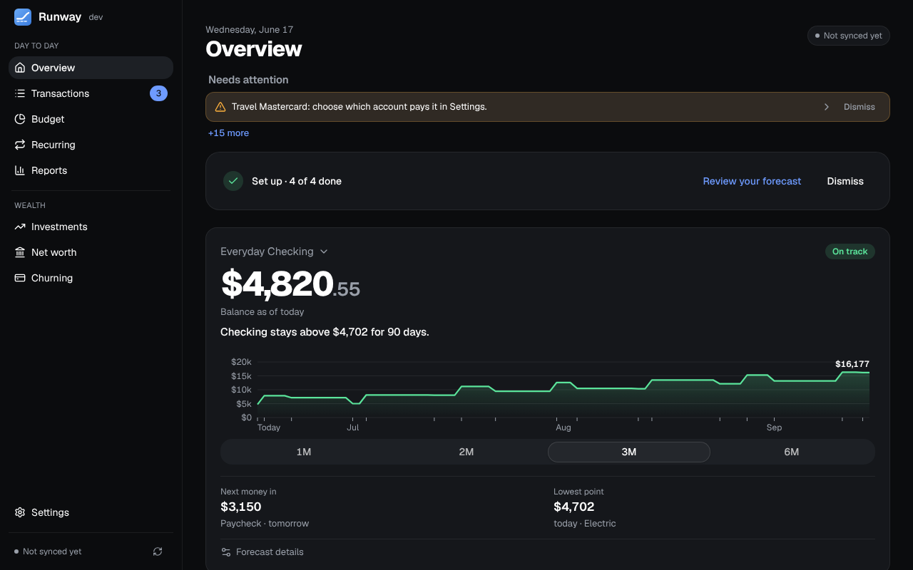
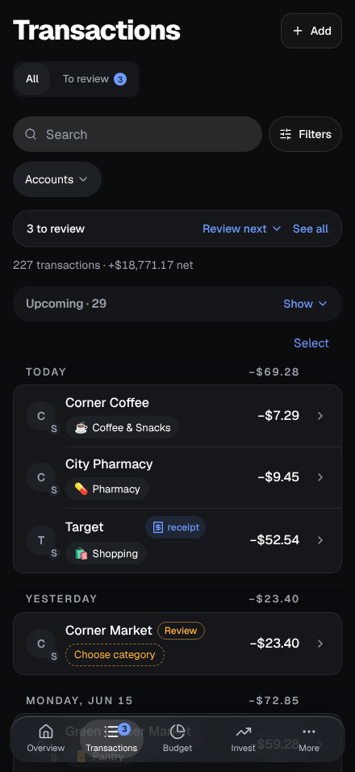
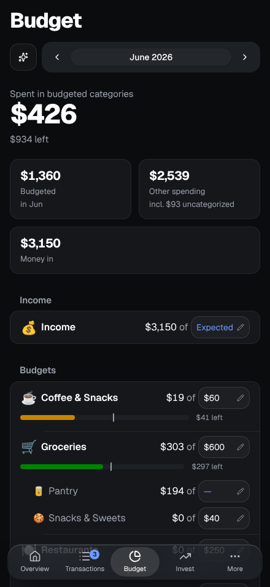
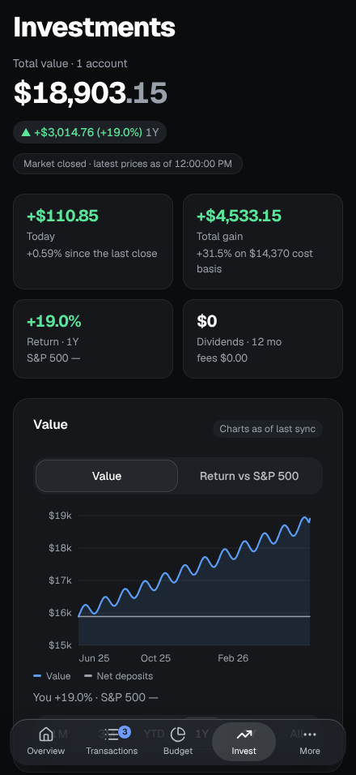

<p align="center">
  
</p>

<h1 align="center">Runway</h1>

<p align="center">
  <b>A self-hosted personal finance app that tells you how much runway your cash has.</b><br>
  Bank sync, a day-by-day cash-flow forecast, budgets, reports, investments and net worth, on your own hardware.
</p>

<p align="center">
  <a href="https://github.com/AnthonyPluth/Runway/actions/workflows/docker.yml"></a>
  <a href="https://codecov.io/gh/AnthonyPluth/Runway?flags[0]=backend"></a>
  <a href="https://codecov.io/gh/AnthonyPluth/Runway?flags[0]=frontend"></a>
  <a href="https://github.com/AnthonyPluth/Runway/releases"></a>
  
  
  <a href="LICENSE"></a>
</p>

<p align="center">
  
</p>

<p align="center">
  <a href="https://anthonypluth.github.io/Runway/"><b>Documentation</b></a> ·
  <a href="https://anthonypluth.github.io/Runway/start/quick-start/">Quick start</a> ·
  <a href="https://anthonypluth.github.io/Runway/using/overview/">Features</a> ·
  <a href="https://anthonypluth.github.io/Runway/reference/configuration/">Configuration</a> ·
  <a href="https://github.com/AnthonyPluth/Runway/releases">Releases</a>
</p>

---

## Why Runway

Most budgeting apps look backwards: what did I spend last month? Runway looks forward. It takes your checking balance, your paychecks and bills, and what each credit card will actually charge you on its due date, and draws the balance day by day for the next few months, so you can see the tightest moment before you get there.

It runs on your own computer or home server, keeps its data in one database you control (SQLite, or Postgres if you prefer), and is written in Python with a handful of well-known libraries.

## Features

- **Cash-flow forecast.** Your checking account, day by day for 30 days to 6 months, with the lowest point in plain language. Credit cards come out on their due dates from real statement balances, and paydays and payments land on business days.
- **Bank sync, account by account.** SimpleFIN or Plaid for each account, once a day and on demand. Switching providers keeps your history.
- **Recurring.** Paychecks, bills and subscriptions on any schedule, matched to transactions automatically, with a flag for payments that didn't happen.
- **Transactions and rules.** Categories with subcategories, split transactions, bulk editing, a review queue, and rules that categorize, rename or split by merchant, amount or account. Optional AI categorization through OpenRouter or your own Ollama server.
- **Store orders.** A browser extension reads your Amazon, Target and Costco orders and splits each card charge by what you bought.
- **Budgets and reports.** Monthly budgets with rollover, a cash-flow Sankey, spending over time, merchants, income against spending, and a drill-down breakdown.
- **Net worth, investments and equity.** Accounts, homes and vehicles minus debts, recorded daily; brokerage performance with live prices; stock options, RSUs and Carta grants; a retirement planner.
- **Churning.** Sign-up bonuses, 5/24, annual fees, card benefits, bank bonuses and a plan for the cards you want next.
- **Notifications.** Web Push alerts for upcoming card payments, a low forecast, missed bills, large charges and more, with no third-party service involved.
- **An assistant-ready API.** An [MCP endpoint](https://anthonypluth.github.io/Runway/using/mcp/) lets Claude or another assistant, once you approve it, answer questions about your money.
- **Yours to keep.** Autosave everywhere, a dark interface that works on a phone (and installs as an app), and one-file backups that restore into SQLite or Postgres.

<p align="center">
  
  &nbsp;&nbsp;
  
  &nbsp;&nbsp;
  
</p>

## Quick start

```bash
git clone https://github.com/AnthonyPluth/Runway.git
cd Runway
cp .env.example .env      # set RUNWAY_PUBLIC_URL, OIDC_ISSUER, OIDC_CLIENT_ID/SECRET, OIDC_ALLOWED_EMAILS
docker compose up -d
```

The image is `ghcr.io/anthonypluth/runway:latest` (Intel/AMD and ARM). Beyond `localhost`, Runway requires sign-in through an OpenID Connect provider such as Authentik, Authelia, Keycloak, Pocket ID, Google or Microsoft Entra. Registering it with your provider, running from source and connecting your first bank are in the [quick start](https://anthonypluth.github.io/Runway/start/quick-start/).

## Documentation

**[anthonypluth.github.io/Runway](https://anthonypluth.github.io/Runway/)**

- **Start here:** [Quick start](https://anthonypluth.github.io/Runway/start/quick-start/), [Install with Docker](https://anthonypluth.github.io/Runway/start/docker/) and [Phone, backups and Postgres](https://anthonypluth.github.io/Runway/start/deployment/).
- **Using Runway:** a page for each part of the app, from the [Overview](https://anthonypluth.github.io/Runway/using/overview/) to [Settings](https://anthonypluth.github.io/Runway/using/settings/), plus the [browser extension](https://anthonypluth.github.io/Runway/using/browser-extension/) and [AI assistants (MCP)](https://anthonypluth.github.io/Runway/using/mcp/).
- **Reference:** [Configuration](https://anthonypluth.github.io/Runway/reference/configuration/) (every environment variable) and [Architecture](https://anthonypluth.github.io/Runway/reference/architecture/) (data sources, how the forecast works, the stack and the security model).
- **Contributing:** [Development](https://anthonypluth.github.io/Runway/contributing/development/).

## Security and privacy

Your data stays in your own database. Outbound calls go only to the services you set up, and the AI (if enabled) sees only the date, amount, merchant text and account type. Sign-in through your OpenID Connect provider is mandatory beyond `localhost`, and bank access and API keys are encrypted at rest. The details are in [Architecture](https://anthonypluth.github.io/Runway/reference/architecture/#security-and-privacy); to report a vulnerability, see [SECURITY.md](SECURITY.md).

## Releases

Each [release](https://github.com/AnthonyPluth/Runway/releases) publishes the image tagged `latest` and by version (`1.2.3`, `1.2`, `1`). Pin a version (`ghcr.io/anthonypluth/runway:1.2`) and upgrade when you choose; database migrations run on start. The running version is under **Settings → Data**.

## License

Runway is licensed under the [GNU Affero General Public License v3.0](LICENSE).

---

<sub>The Inter typeface is © The Inter Project Authors and the Geist typeface is © Vercel, both used under the SIL Open Font License (<a href="runway/static/fonts/Inter-LICENSE.txt">Inter</a>, <a href="runway/static/fonts/Geist-LICENSE.txt">Geist</a>).
Merchant, bank and card logos are from Plaid and <a href="https://logo.dev">Logo.dev</a>. They're trademarks of their owners.</sub>
