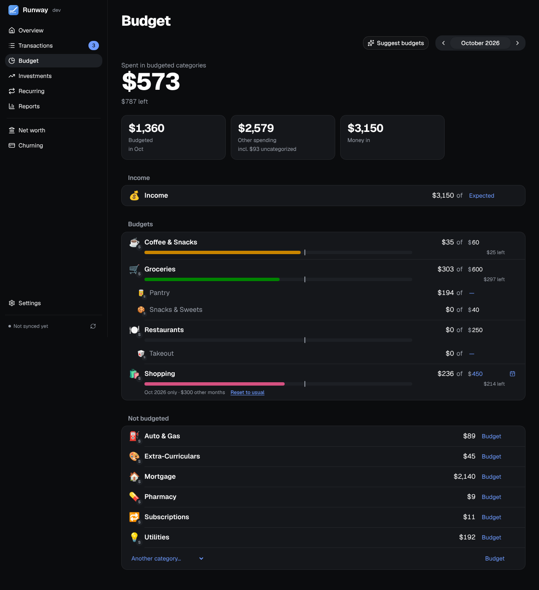
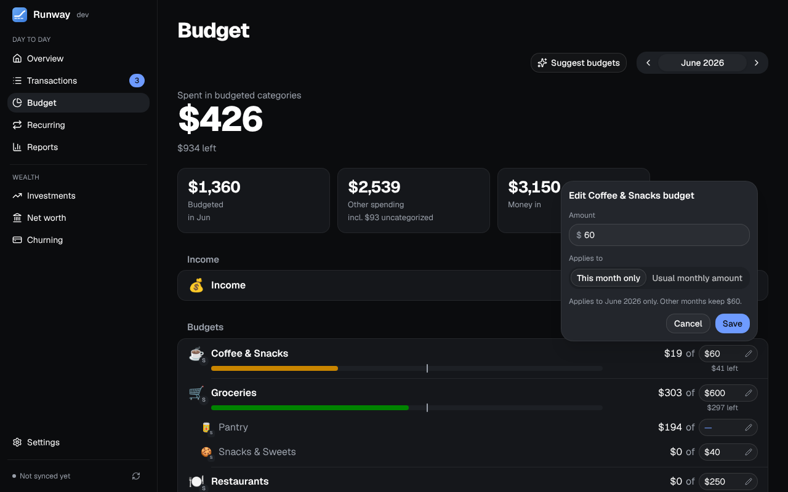

A monthly budget per category, with how much of it is spent and what's still coming.

## Reading the page

- Each budget's bar shows what's spent, then, shaded, what's still coming this month (recurring items not yet paid, on cards too), against a pace marker for how far through the month it is. Click a category to see its transactions, with what's still coming above them.
- A subcategory's budget sits under its parent's bar, in red when it's over; a parent grows to cover its subcategories' budgets.
- An income category can have a budget too, for what you expect to come in. It has its own green Income group and never counts toward what's budgeted or the forecast.
- The card a category's spending goes on is set per category under Settings → Categories; its bank's logo shows on the category's emoji. The forecast spends each budget on that account or card.

## Editing a budget

Click a budget's amount (the field with a pencil) to open its editor: the **Amount** and, for a budget that already has one, whether it's for **This month only** or the **Usual monthly amount**. Nothing changes until **Save**. Saving no amount as the usual amount removes the budget.

- **A month of its own:** gifts in December or a trip in the summer. The months before and after keep the usual amount, and a note under the row says so. **Reset to usual** takes the month back, with Undo.
- **Rollover**, budget by budget, from the ⋯ menu on a row: what's left at the end of a month is added to the next (going over isn't carried). A budget that rolls over says **Rolls over** beside its name.
- **Suggest budgets** works out a monthly amount for each category that has a budget, and for each top-level category without one, from the median of the last six full months' spending or the recurring bills the forecast has for it, whichever is more, rounded up to the next $5. Each suggestion shows what it's from; apply them one by one or all at once.

## Moving between months

The arrows beside the month move you through them. While another month loads, the one you were on stays in view, and if the new one can't be loaded the old figures stay with a notice and **Retry**. Edits are off until the month on screen is current, so a change can't land on figures that may be out of date.
