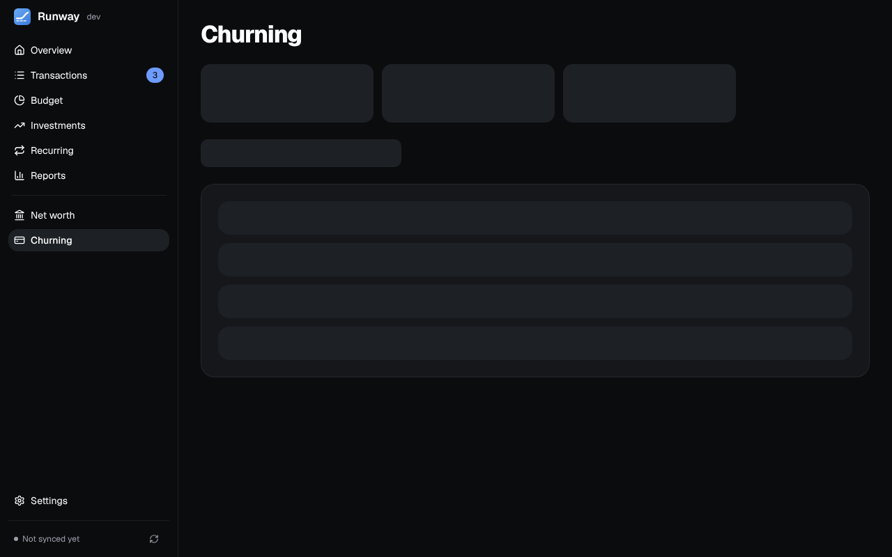

Credit cards and bank accounts opened for their sign-up bonuses, for you and your partner. Tiles for 5/24, annual fees and bonuses sit over four tabs: **Overview** (Upcoming, Planned, Best card for… and Rewards), **Cards**, **Benefits** and **Bank bonuses**.

## Cards

- **Found on your accounts:** every credit card Runway already syncs that isn't a churning card yet, pre-filled from what the bank reported. **Add** opens the form to review it; **Dismiss** hides one. Banks don't say when a card was opened, so check the date: 5/24 and the bonus rules depend on it.
- **Adding a card:** whose it is, the bank, the card, the day it was opened and the annual fee up front, with earning rates, the sign-up bonus, benefits, your plan and more details in sections that start closed. The annual fee posts in the card's anniversary month.
- **Fill in the rest:** with an OpenRouter key or Ollama set up, a button asks the model about the card (what it earns, the fee, benefits, the current public bonus) and fills what's still empty, marked "Suggested by AI, check before saving". With OpenRouter it searches the web first and lists the pages it used; only the bank's and card's names are sent. Nothing is saved until you add the card.
- **5/24** per person, with the day each card stops counting (authorized-user, business and product-changed cards left out).
- **Annual fees** coming up, with your plan for each card: keep it, or downgrade or close it and be reminded before the fee. The fee shows net of the credits you use, and lands in the cash-flow forecast through the card's statement unless you plan to close the card first.
- **Bonus spending** is followed from the linked account, counted the way Reports counts spending, with how much a day the rest needs. When a bonus can be earned again follows each bank's commonly reported rule, which you can override.

## Benefits and bank bonuses

- **Benefits and credits:** what's left this period, **Mark used** (asking how much of a credit), and reminders before a credit resets.
- **Bank bonuses:** direct deposits followed from the linked account, due dates, safe-to-close days and fee-waiver reminders, and bonus money per year. Paid or closed bonuses fold into a collapsed group.
- **Best card for…** answers which card to use for a purchase by category, including rates earned only through an issuer's travel portal, and **Rewards** estimates your points by program at values you can change.
- **Planned:** the cards and bank bonuses you want next, with what's in the way (5/24, bonus rules) and the earliest day to apply, plus your own to-dos.

Deadlines are red within 7 days or once overdue and amber within 30. What can be put back offers Undo in a toast; what can't (deleting a card with its benefits) asks first.

AI assistants connected over [MCP](/Runway/using/mcp/) can read all of this, and change it once you allow it.
