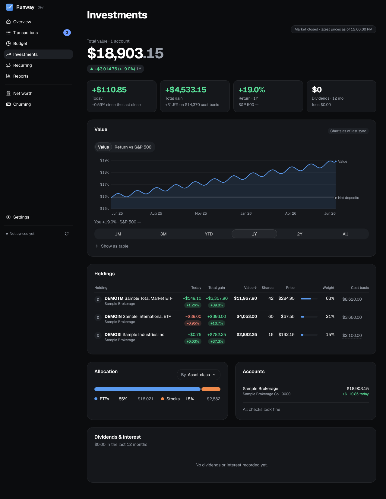
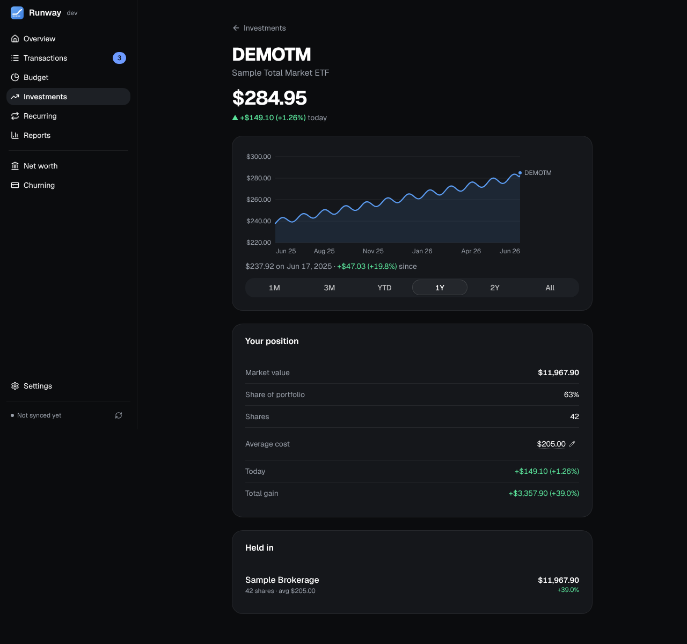

Holdings and performance for your brokerage and retirement accounts, from the positions SimpleFIN or Plaid report. Accounts neither can see into, like some 401(k)s, can be tracked by hand.

## The page

- **The headline:** your total value, the gain over the chosen period (dollars and percent) and how far ahead of or behind the S&P 500 you are. Under it, **Today** (the change since the last close), **Total gain** (against cost basis), **Return** for the period beside the S&P 500's, and **Dividends** over the last 12 months with the fees.
- **The chart** switches between your value with your net deposits and your time-weighted return against the S&P 500. The period selector (1M, 3M, YTD, 1Y, 2Y, All) sets the headline, the tiles and the chart together.
- **Holdings:** each with Today, Total gain and Value, then shares, price, weight and cost basis on a wide screen. On a phone the holdings are a list, with a **Today / Total / Weight** switch for what each row's pill shows; tap the switch's chosen option again to sort by it.
- **Allocation** by asset class, account, sector or top holdings, **Accounts** with each investment account's value and today's change, and **Worth a look**: the checks that need attention (a single holding or account that's most of the portfolio, uninvested cash, fees paid, an emergency fund of less than three months' spending, holdings without a cost basis), or "All checks look fine".
- **Cost basis** can be edited per share where the institution's figure is wrong or missing: click the figure; leave it empty to go back to the institution's.

## A holding's page

Click a holding's name (tap its row on a phone) for its page: the price, today's change, a price chart over the chosen period, **Your position** (value, share of the portfolio, shares, average cost, today's and total gain), **Held in** for each account holding it, and the dividends it paid over the last 12 months.

## Prices

Daily prices come from Yahoo Finance. While the market is open, prices update live; with a free [Finnhub](https://finnhub.io) key (Settings → Connections) they become real-time trades for up to 50 of your stocks and ETFs, with Yahoo for the rest. Live prices re-price the totals and holdings; the charts are the last sync's. "Holdings updated …" turns amber once they're more than two days old.

## How it's worked out

- **History** is rebuilt from activity where Plaid provides it, otherwise from the position snapshots Runway saves on every sync. A change in positions between snapshots counts as money added or withdrawn, not as a gain, and returns are time-weighted.
- **Which accounts count:** every investment account, unless you hide it in Settings → Accounts, which also leaves it out of the retirement plan. An account both SimpleFIN and Plaid send is counted once.
- **Tracked by hand:** an account with a balance but no holdings sits under "Accounts without automatic holdings" at the bottom. Enter its shares and your contribution split, and Runway invests each new deposit accordingly, warning when the funds you entered drift from the synced balance.
- **Logos** come from Logo.dev with a key: a stock's by its ticker, a fund's by its fund family.
