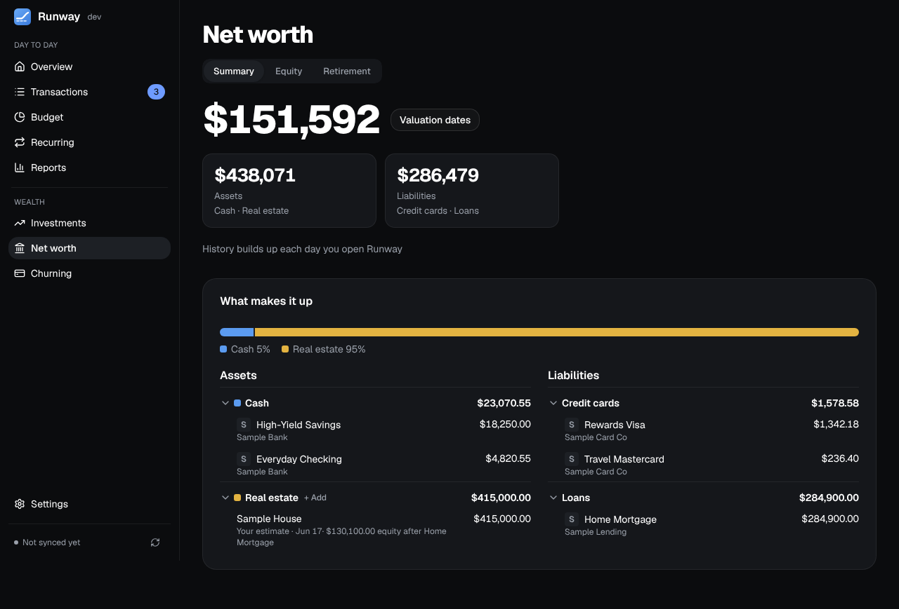
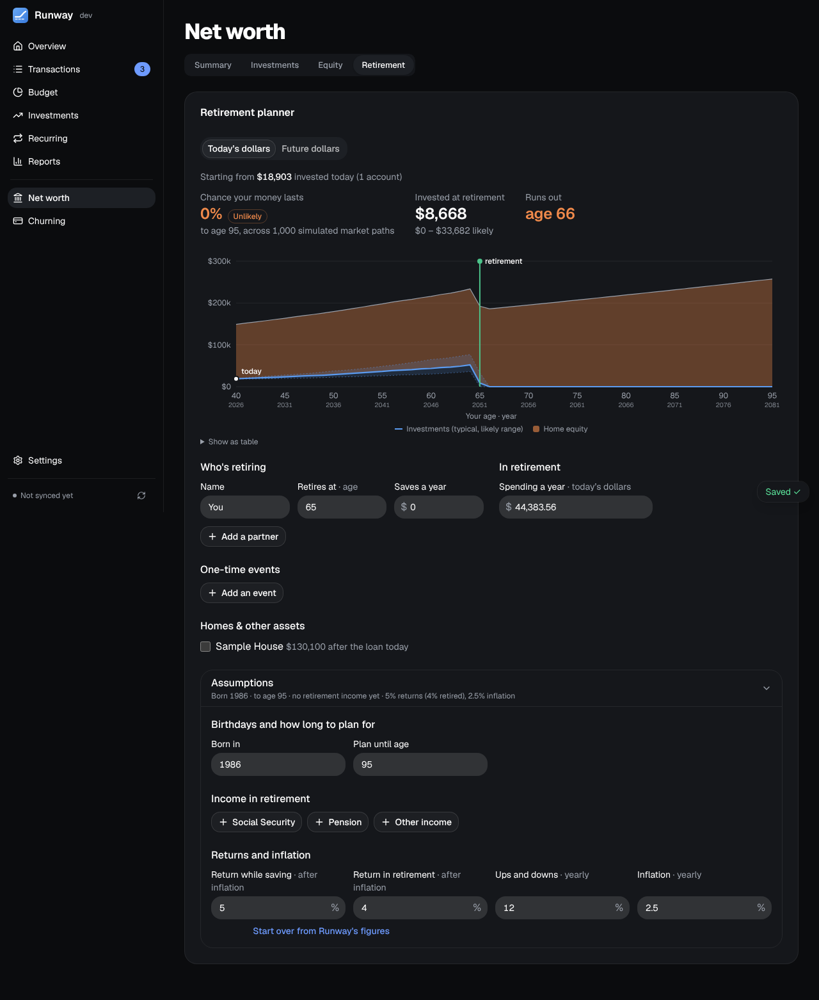

Three tabs: **Summary**, **Equity** and **Retirement**.

## Summary

- Every account plus homes, vehicles and anything else you own, minus cards and loans, recorded each day you open Runway. The change over 1M, 3M or 1Y ("+$4,210 (+2.9%) in the last month") is measured from the latest snapshot at least that old. Until there are two days of history, a dashed box where the chart will be says it builds up each day you open Runway. Pointing at the chart shows that day's total.
- **Homes** can be valued automatically through [Realie](https://www.realie.ai) (a key under Settings → Connections, each home looked up at most weekly) or by hand; vehicles and other assets by hand, with a yearly change if you like.
- **Loans go down between updates:** a loan with an interest rate and monthly payment (the lender's through Plaid, or what you enter under Settings → Accounts) is paid down month by month from its last balance, so a home's equity grows even when the bank doesn't send a new balance.
- **What makes it up** lists each kind of asset and debt in its own colour. Debts that are all $0 show as "Nothing owed".

## Equity

Stock options (ISO and NSO), RSUs, restricted stock and shares, each with its vesting schedule (cliff, monthly or quarterly), exercise price and exercises. Runway shows what has vested and what's to come at each company's latest share price, before tax, and counts the vested part in net worth; a price about three months old is flagged. The vesting chart has a line per company. Enter grants by hand, or read them from **Carta** with the [browser extension](/Runway/using/browser-extension/).

## Retirement

A planner that projects your investments year by year to the age you plan for, across 1,000 simulated market paths, with the chance your money lasts and a word for it (**Likely** at 85% or more, **Uncertain** from 70%, **Unlikely** below).

- **It starts from your numbers.** The first visit opens on **Review your assumptions**: each person's birth year and retirement age, saving, spending in retirement, the planning age, returns and inflation, with where each of Runway's figures comes from. Spending is your average over the last six full months as Reports counts it; saving is what went into your investments in the last 12 months. Change anything, then **Show my projection** saves the plan. **Start over** goes back to Runway's figures.
- **Two people:** each person's saving stops at their own retirement, and spending comes from the investments once both have retired.
- **Homes, other assets and equity** stack on top of the investments until the year you choose to sell each into the plan; from then its proceeds (before selling costs and tax) are in the investments. A home's loan is paid down to what will still be owed that year. Vehicles are left out.
- **Loans:** a student or personal loan is listed with what's owed and paid down on its terms, and once it's paid off its payment comes off your spending in the projection. The page says, for each loan, whether its payment is in your spending and when it ends.
- **Income in retirement** (Social Security, pensions) and one-off events go under **Assumptions**.
- Figures are in today's dollars; a switch shows them in future dollars instead. The plan itself doesn't change.
