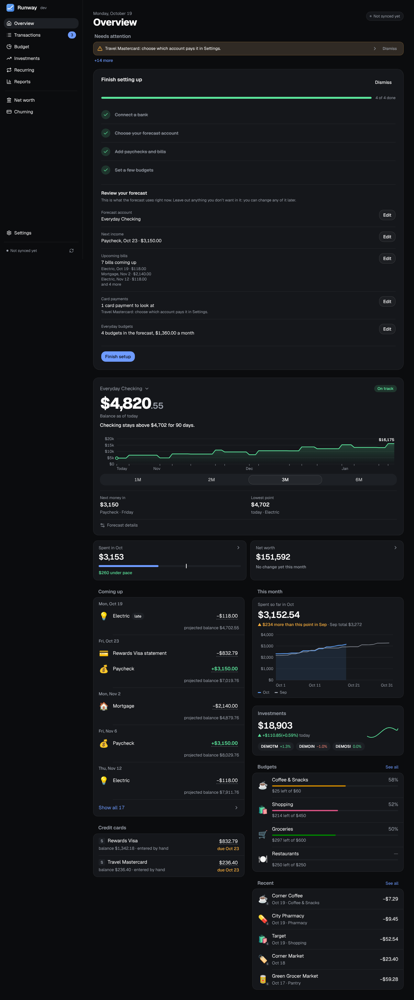

Runway's pages sit in the sidebar (a tab bar at the bottom on a phone, a rail of icons on a tablet), in two groups: **Day to day** (**Overview**, **Transactions**, **Budget**, **Recurring** and **Reports**) and **Wealth** (**Investments**, **Net worth** with its Summary, Equity and Retirement tabs, and **Churning**), with **Settings** at the bottom. The phone's tab bar keeps Overview, Transactions, Budget and Invest, with the rest under **More**. Every page and editor works at any width; this guide has one page for each.

Overview is the forecast: your chosen account's balance, day by day, for the next 30 days to 6 months.

## The forecast

- **The chart** draws the forecast account's projected balance, with the lowest day marked and the end balance written out. Hover over it (drag sideways on a phone) for a day's balance and what happens that day. From the keyboard, Tab to the chart, then the arrow keys step a day, Home and End go to the first and last day, and Escape puts the readout away. **Lowest balance** under the chart jumps to the lowest day.
- **The headline** says it in words: an **On track** or **Heads up** chip, the balance, and "Checking stays above $2,084 for the next 120 days". **Next money in** and **Lowest point** sit beside it, and **Forecast details** opens what the forecast counts.
- **Length:** 1M, 2M, 3M or 6M under the chart. Click the account name above the balance to choose the forecast account and the default length. An account can also be chosen under Settings → Accounts (**Use for the forecast**); it's marked **Forecast** there.
- **Coming up** lists each day's items under its date, with the projected balance after them. The same list is **Upcoming · projected** at the top of Transactions, in italics so projected rows aren't mistaken for posted ones.

### What moves the balance

- **The starting point** is the bank's balance plus what's pending, in and out ("Balance as of today, including −$375.00 pending"). A bank whose balance already has the pending charges taken out isn't charged them twice.
- **Recurring items** on their dates: paychecks, bills and subscriptions from [Recurring](/Runway/using/recurring/). A payment due on a weekend or bank holiday lands on the next business day, a paycheck on the business day before.
- **Credit card payments** come out of the paying account on each card's due date. The statement balance, closing date, due date and minimum come from the issuer through Plaid where the bank shares them; for any other card, enter the latest statement on the card under Settings → Accounts. By default a statement is paid in full; beside the paying account you can choose **Pay: minimum** or **a fixed amount** instead, and whatever's already been paid since the statement closed comes off it.
- **Future statements** are estimated from what you've planned, not from past spending: the charges so far this cycle, then each cycle's budgets paid with the card, the card's recurring items, and any annual fee on a churning card. Under **Upcoming** on Transactions, a projected card payment expands to show the estimate ("Charged so far", the budgets and the recurring charges).
- **Budgets** are spent a little each banking day on their account or card, so a day's balance is after that day's budgeted spending. A note under the chart says how much a month that is, and which budgets are left out (one on an account that isn't in the forecast).
- **Nothing is estimated from past spending** on the account itself: only scheduled items, card payments and budgets move the balance.

### Adjusting it

- Click any upcoming amount to change it for that date only, with Undo. For a repeating item, **From now on** in the same message makes it the item's amount. A recurring item's name opens it on Recurring.
- **Known limitation:** with more than one account in the forecast, a transfer between them counts only as money out unless you add the matching money in on the other account as its own recurring item.

## Needs attention

The first alert shows as a banner, with **+N more** for the rest. Each links to its fix: a card without a statement opens that card's Statement in Settings → Accounts, a card with no paying account opens Settings → Accounts, a recurring payment that didn't show up offers **Link a transaction** and **Skip this one**, and big payments the forecast leaves out (payments over $1,000 in the last 90 days that aren't transfers or recurring items) open Recurring so you can add them.

**Dismiss** puts an alert away, with Undo; it stays away while its message reads the same and comes back when the problem changes. **Show dismissed** brings one back.

## The rest of the page

- **This month:** its heading links to Budget. A bar shows what your budgeted categories have spent against what they're budgeted, with a marker for how far through the month it is and a line saying how far over or under pace you are; then the comparison with last month, the day-by-day chart, the budgets closest to their limit and the latest transactions.
- **Net worth:** a tile with the total and its change this month, linking to Net worth.
- **Investments:** with an investment account, a card shows the portfolio's value, today's change, the last month as a small line and the three holdings that moved most today, with live prices while the market is open. It opens Investments.

## The setup checklist

A new Runway opens with four steps: connect a bank, choose your forecast account, add paychecks and bills, set budgets. Each has a line on what it means, and the later steps wait until there's an account. When all four are done the card shrinks to one line; **Review your forecast** on it opens a review of what the forecast uses (the account, the next income, upcoming bills, card payments that need attention, the budgets in the forecast), each with an **Edit** link. **Finish setup** puts the checklist away, with Undo. To see the review again, open the forecast settings from the account name and choose **Review your setup**.
