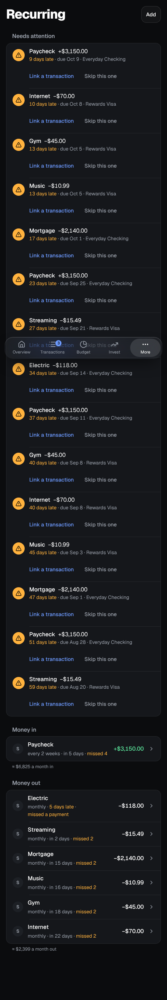
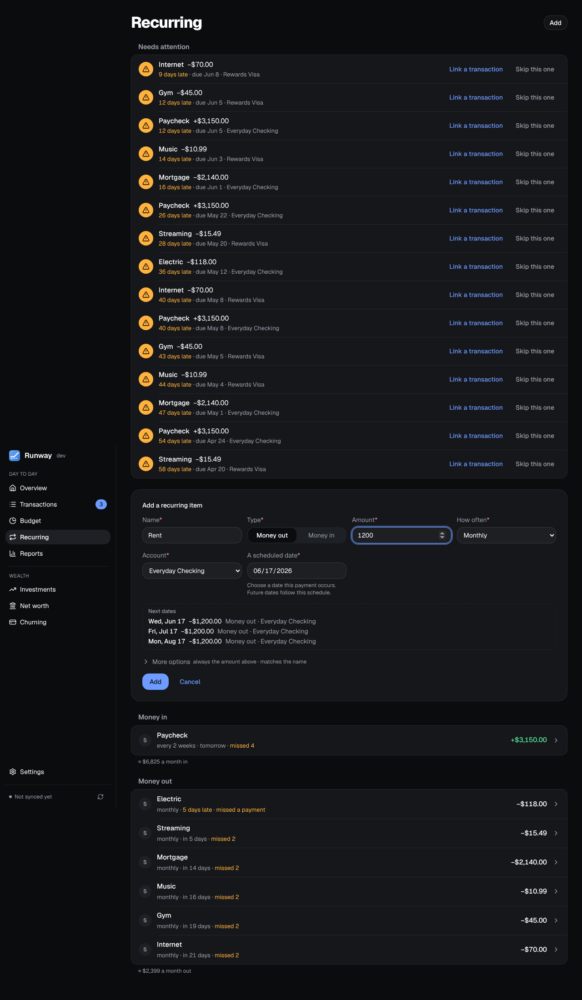

The items the forecast expects: paychecks and other money in, bills and subscriptions out, on any schedule. It works without a bank too, for items you add by hand.

## The list

Items are grouped into **Money in** and **Money out**, late ones first and then by when each is next due ("in 9 days", "tomorrow", "3 days late"), with what each group comes to a month ("≈ $2,400 a month out"). Click a row to open its fields in a panel (a sheet on a phone), each saved as you change it, with **Pause**, **Skip the next one** and **Remove**.

- **Schedules:** weekly, every two weeks, twice a month, monthly, quarterly, twice a year, yearly, specific dates (property tax on April 15 and October 15), or **Once** for money you expect on one date only.
- **Amount:** a fixed amount, the last payment, or the average of the last three. When a fixed amount's recent payments all came to something else, the row says "Usually $87.40" and offers it.
- **Pause** takes an item out of the forecast until you **Resume** it; **Ends on** is the last day it can come; **Skip the next one** leaves out just its next date, with Undo.
- **Category:** an item can have a category, which a transaction matched to it takes when it has none of its own.
- **Logos:** each item shows its merchant's logo from its last matched transaction; click it to choose another.

## Adding an item

**Add** asks for a name, money in or out, the amount, the account, how often and a scheduled date (any date the payment falls on). **Next dates** previews the next three times it would come, moved off weekends and bank holidays by the same schedule the forecast uses. Merchant texts, the end date and an amount range are under **More options**.

**Spotted in your history** suggests items from repeating transactions on your accounts and cards, with the range when the amounts vary: **Add** takes one as it is, **Edit first** fills the form, **Not recurring** hides it.

## Matching

Transactions are matched to their item automatically by merchant text, on the item's account and the same way the money moves, whatever the amount. An item can have several texts, one per line, and an amount range ("Only amounts between $1,500 and $7,000") to leave out other payments with the same text. To link one by hand, use the repeat icon on a transaction (on a phone, **Link to a recurring item** in its details); Runway offers to match its text from now on.

Payments for one date are added up, so a paycheck in two deposits is one payment. When a fixed amount comes in short by more than 10%, the rest is still expected until the payment's window closes.

## Missed payments

A payment that didn't come is listed at the top of Recurring and on Overview under Needs attention, with how late it is. **Link a transaction** lists the unlinked payments on its account around that date; **Skip this one** says it isn't coming, with Undo. An item that missed several is one row ("4 missed since …") with **Skip all** and **Show each**, and once it has missed three or more in a row, **Mark as ended** gives it an end date so the forecast stops expecting it.
