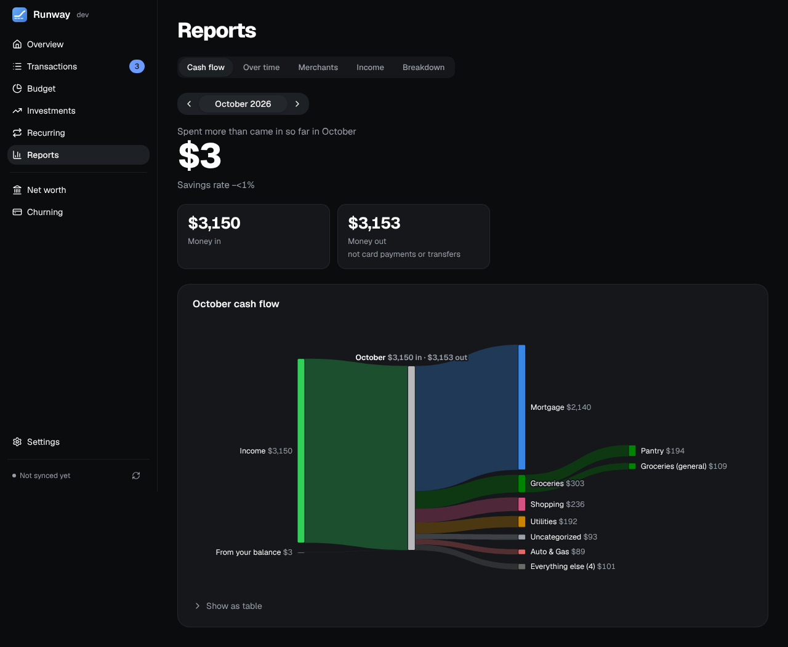

Five views of where your money went. Categories wear the colours they have on Budget, and anything you click opens its transactions on Transactions, already filtered (on a touch screen the first tap shows the figure and a second opens it).

- **Cash flow:** a Sankey chart of a month's money in, through categories, to money out.
- **Over time:** spending by category, merchant or account over 6, 12 or 24 months, with each one's change from last month and a year ago. The month under way is drawn faint and marked "so far", compared with the same days of last month ("vs Sep 1–3"); only a month that's over is flagged red for spending more than came in.
- **Merchants:** ranked by what you spent, each with its months and transactions. The search covers every merchant, not just the top 100.
- **Income:** money in, money out, what's left over and your savings rate, with tiles for this year so far.
- **Breakdown:** a treemap you click into, from categories to subcategories to merchants to the transactions behind them.

Over time and Income start at the first full month of your history, so a partial first month doesn't pull the averages down. Cash flow, Over time and Breakdown have their numbers as a table too. If a report can't load it says so with **Retry**, and while it reloads the last figures stay on screen, dimmed.
