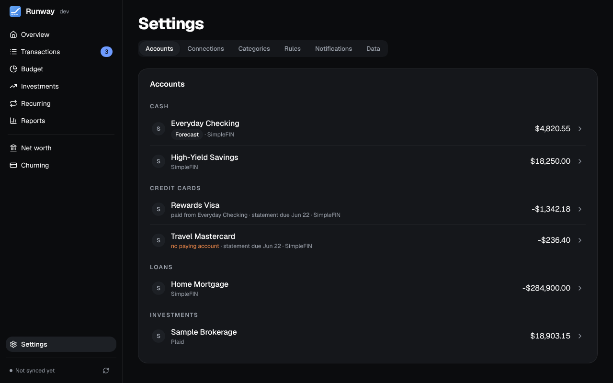

Settings has six tabs: **Accounts**, **Connections**, **Categories**, **Rules**, **Notifications** and **Data**. Until a bank is connected it opens on Connections.

## Connections

Two ways to connect a bank, one open at a time:

- **SimpleFIN** (recommended, about $15 a year): create a setup token in [SimpleFIN Bridge](https://beta-bridge.simplefin.org) and paste it in. The first sync pulls about six months of history, with balances, transactions and investment positions.
- **Plaid**, with your own developer keys: up to two years of history, and card statements, due dates and loan terms (Plaid Liabilities) where the bank shares them. Banks that sign you in on their own site send you back to `<RUNWAY_PUBLIC_URL>/plaid/oauth`: add that address under Allowed redirect URIs in the Plaid Dashboard.

You can mix the two account by account. Switching an account's source keeps its history; transactions both providers have are matched up so nothing is counted twice.

The optional services live here too: **OpenRouter** or **Ollama** for [AI categorization](/Runway/using/transactions/#ai-categorization) and card lookups, **Realie** for home values, **Finnhub** for real-time prices, **Logo.dev** for merchant and bank logos, and the [browser extension](/Runway/using/browser-extension/) for Amazon, Target, Costco and Carta. A service with an error says **Needs attention** with the problem in a sentence. Keys are hidden as you type and stored encrypted.

**Sync** runs once a day at 7 AM in Runway's time zone (`TZ`), late enough for overnight ACH, and whenever you press **Sync now** in the sidebar.

## Accounts

Every account from your banks, with its source, balance and last sync.

- **Rename or hide** an account from its row. A hidden account is left out of lists, totals, the forecast and the investment pages; its transactions are kept.
- **Use for the forecast** marks the account Overview forecasts.
- **Credit cards:** the card's **Statement** (the issuer's through Plaid, or the one you enter: closing date, balance, due date and minimum), the account that pays it and how (**Pay:** in full, the minimum or a fixed amount).
- **Loans:** the interest rate and monthly payment, from the lender through Plaid or entered by you, for the loan's paydown on Net worth and in the retirement plan.
- **Owner:** whose account it is, a label for Churning and the retirement plan.
- **Delete** an account, its transactions, statements and the rules that only apply to it. It stays deleted through syncs; **Restore** under the list brings it back with the next sync.

## Categories and rules

[Categories](/Runway/using/transactions/#categories) have one level of subcategories, each with an emoji, a colour and the card its spending goes on. Removing one that's in use asks where its transactions should go. [Rules](/Runway/using/transactions/#rules) categorize, rename, split or send transactions to review.

## Notifications

Web Push to your phone or computer: a card payment coming up, the forecast getting low, a recurring payment that didn't show up, a large charge, a sync that keeps failing, the browser extension waiting for a store sign-in, and Churning's deadlines. Each alert is sent once, and notifications are each person's own. Turn them on from the device that should get them (inside the installed app on an iPhone); the Devices list shows each one. Setting up the app on a phone is in [Phone, backups and Postgres](/Runway/start/deployment/#on-your-phone).

## Data

- **App lock:** Face ID, Touch ID or the device's passcode before Runway shows anything on this device, when you open it and when you come back after 1, 5 or 15 minutes in the background. Each device turns it on for itself, and signing out turns it off. See [App lock](/Runway/start/deployment/#app-lock-face-id--touch-id).
- **Backup and restore:** one file holding everything, restorable into SQLite or Postgres. Choosing a file shows what it holds before **Restore** asks you to type `RESTORE`; a copy of what was there is kept in the data directory. See [Backups](/Runway/start/deployment/#backups-and-restore).
- **AI assistants (MCP):** Runway's address for assistants, the ones you've approved (with **Disconnect**), and the switches that let them change churning, categorize, or change anything. See [AI assistants](/Runway/using/mcp/).
- **Version:** the release you're running.
