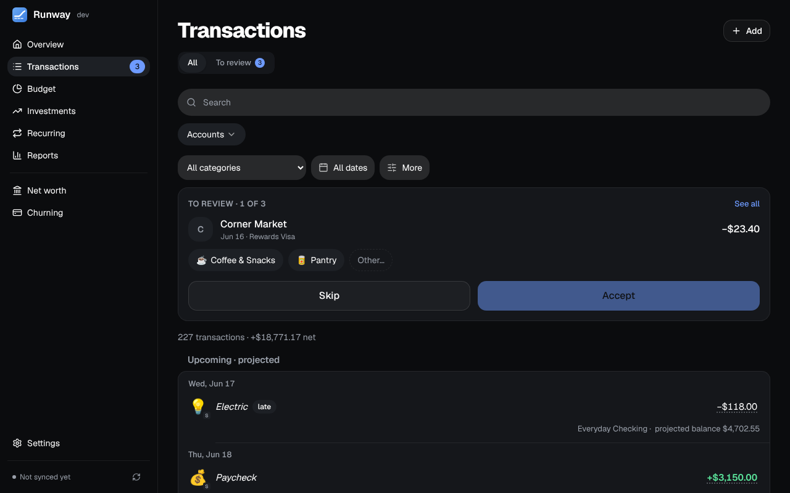
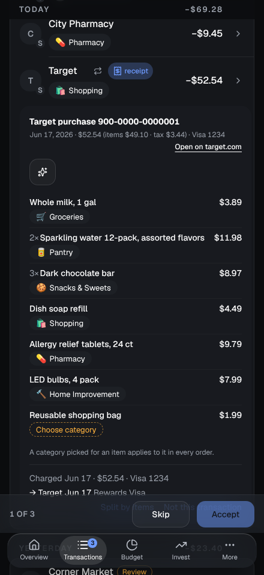

Every transaction from your banks, grouped by day, with a **To review** tab for the ones waiting on a category.

## The list

- **Search and filters.** The search matches the merchant, the bank's text, the category, your note, or an amount typed as a number. Beside it are the account, the category and the dates (This month, Last 3 months, This year, All time, or your own range, which can reach ahead of today); under **More**, the kind (money in, out or transfers) and an amount range. On a phone, the account, category, dates and More sit behind one **Filters** button, which shows how many are on. Active filters show as chips you can remove, and **Clear filters** clears them all. The filters are part of the page's address, so a reload, Back or a bookmark keeps them.
- **Grouped by day**, under Today, Yesterday and then dates, each with the day's net total (transfers left out), and the line under the filters says how many transactions match and what they add up to. **Upcoming · projected** at the top lists what the forecast expects, in italics.
- **Details:** click a transaction's name (or the › at the end of its row) for a panel on the right, a sheet from the bottom on a phone. Change the name, category, date, amount or note; each saves when you leave the field, with Undo. It also shows the account, the bank's own text, who set the category, and the split, recurring item or receipt. **Exclude from reports and budgets** marks it Ignore; **This is a transfer** gives it the Transfer category. A date or amount you change on a synced transaction stays yours.
- **Merchant names** are tidied from the bank's text: processor prefixes ("SQ *", "TST*"), store numbers and ACH words come off, and big brands get their own name ("AMZN Mktp US*2K3AB1" is Amazon). The bank's text stays under the details, with **Use the bank's name** to put it back, for one transaction or for the brand.
- **Logos** come from Plaid, and with a free Logo.dev key (Settings → Connections) from Logo.dev for the rest. Click a logo to choose another, or none.
- **Add** records a transaction the bank doesn't have, such as cash. It counts in reports and budgets; the account's balance still comes from the bank.
- **Delete** from a transaction's details, or tick several and use **Delete** in the bar above the list (up to 2,000 at once). Deleting asks first and can't be undone; a bank-synced transaction may come back on a later sync. A deleted charge still counts toward its card's next payment in the forecast while the card's balance has it.

## Bulk editing

Tick transactions (Shift-click for a range) to give them a category, rename their merchant or accept their categories together. With every row ticked, **Select all 212** takes in every one the filters match. On a phone, **Select** makes a tap on a row tick it.

## Review

A transaction with no category, or one a rule or the AI wasn't sure of, waits on **To review**. A card at the top of All shows them one at a time ("To review · 1 of 12") with the suggested category, two others from your recent transactions and **Other…** for the full picker; **Accept** saves and moves on, **Skip** comes back to it later. On To review, each row's ✓ accepts it, and **Accept all ≥ 90%** accepts every one Runway is that sure of. On a computer, **j** and **k** move between rows, **Enter** accepts, **c** opens the category, **i** marks Ignore, **t** Transfer and **s** opens the split editor. Changes made one after another share one toast ("3 changed · Undo").

On a phone the review card starts as one line with **Review next**, and when you scroll past it a bar with **Skip** and **Accept** sticks above the tab bar.

## Categories

Categories have one level of subcategories, each with an emoji and a colour, under Settings → Categories. Pick a category from a row's pill: type to narrow the list ("gro" for Groceries), arrows move, Enter picks. A subcategory is indented under its parent, and searching writes it as "Snacks & Sweets · Groceries". Hover a pill for the whole path.

When you pick a category, the toast offers **Always for** the merchant: a rule, with how many other transactions it would change, so nothing writes a rule behind your back. What you've categorized **Ignore** stays off the All tab unless you choose **Show** on the "N ignored" line.

## Rules

Settings → Rules. A rule has conditions (the merchant contains, is or starts with some text; the amount is in a range; money in or out; a particular account) and actions (set a category, rename the merchant, split by percentages, or send it to Review). When several match, the most specific wins. A preview shows what a rule would match before you save it, and **Apply to past transactions** says how many it would change and asks, with Undo. Built-in rules handle card payments and transfers.

## AI categorization

Optional, through [OpenRouter](https://openrouter.ai) (a key under Settings → Connections) or your own [Ollama](https://ollama.com) server (choose the provider and enter its address; from Docker, an address the container can reach, such as `http://host.docker.internal:11434`). For each new merchant the model is sent the payee, the bank's description, one recent amount, the date and the account type, plus your category names and examples of how you've categorized; never account names or numbers. With OpenRouter only providers that don't keep or train on what they're sent are used.

Suggestions show as High, Medium or Low. Confident ones can be applied during sync; the rest wait on To review, where **Suggest categories** lists the biggest merchants with **Apply all High**, and a merchant you **Skip** isn't asked about again. Every AI call is logged under Settings → Connections. Every button that asks the AI has a sparkles icon.

## Splits and receipts

- **Split transactions:** a $100 run to Target can be $60 Groceries and $40 Shopping. The editor shows what's left to assign and splits evenly in one click; Save waits until the parts add up. Budgets, reports and filters count each part on its own, and filtered by a category a split transaction shows just its part ("−$42.44 of $60.88").
- **Receipts:** with the [browser extension](/Runway/using/browser-extension/), a card charge matched to an Amazon, Target or Costco order has a **receipt** badge. Click it for the items, each with its category (the AI's, if set up, or one you picked, which sticks for that item in every order), and Runway splits the charge by what you bought, tax and shipping shared out.

